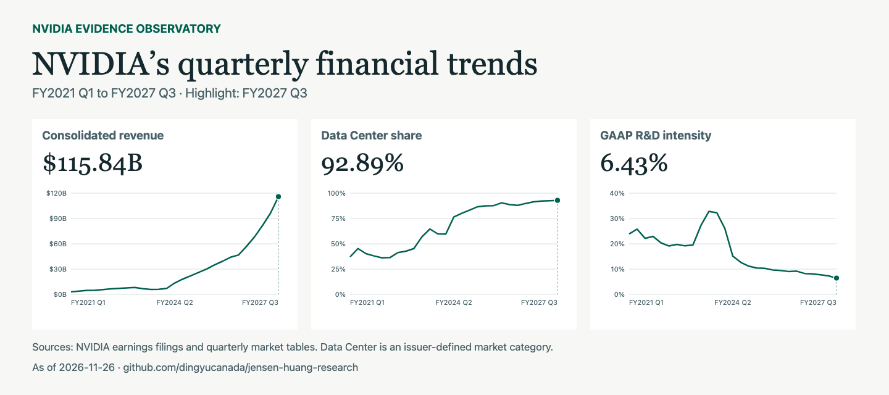

# Jensen Huang Research Project

**Two SEC filings place Jensen Huang’s resignation and reinstatement 11 days apart.** Across 27 fiscal quarters, Data Center’s share of NVIDIA revenue grew from 37.05% to 92.89%. The NVIDIA Evidence Observatory connects those findings, U.S. chip rules, and CUDA’s history to records you can check yourself. [Governance timeline](docs/timeline.md) · [Quarterly sources](docs/quarterly-financial-panel.md)

**Evidence reviewed through November 26, 2026** · 41 timeline events · 27 fiscal quarters · 18 policy records · 17 archive entries

[**Download the interactive observatory**](https://github.com/dingyucanada/jensen-huang-research/releases/download/v0.2.0/jensen-huang-research-v0.2.0.zip) · [**Read the November briefing**](docs/brief-2026-11-26.md) · [Browse the evidence ledger](sources/evidence.md)

Extract the ZIP and open `observatory/index.html`. Search, chart inspection, and CSV and PNG exports work offline. [Observatory guide](docs/observatory.md)

## The November leadership transition

[](research/06-november-2026.md)

NVIDIA’s board accepted Huang’s resignation **effective November 11** and named Colette Kress interim CEO. It reinstated Huang **effective November 22**. Each action was disclosed the following day. The same public record describes an inquiry that NVIDIA said would continue. [Departure filing](sources/evidence.md#clm-001) · [Reinstatement filing](sources/evidence.md#clm-002) · [Inquiry status](sources/evidence.md#clm-003)

[Read the 41-event timeline](docs/timeline.md) · [Get the timeline CSV](data/timeline.csv)

## Where does NVIDIA’s revenue come from?

In **FY2027 Q3**, which ended October 25, 2026, NVIDIA reported **$115.844B** of revenue. Data Center accounted for **$107.610B**, or **92.89%**. GAAP R&D reached **$7.454B**, or **6.43%** of revenue. At the start of the series, R&D was **$0.735B** and **23.86%** of revenue. [Figures, source tables and definitions](docs/quarterly-financial-panel.md)

[](docs/quarterly-financial-panel.md)

[Get quarterly CSV](data/quarterly_financials.csv) · [Get annual CSV](data/annual_financials.csv) · [Reproduce the metrics](docs/metrics.md)

## What should readers watch in chip policy?

- **Rules and deadlines.** The BIS remote-access rule took effect November 19, with comments due January 19, 2027. A separate Entity List amendment was published November 25 and took effect November 23. [Remote-access rule](sources/evidence.md#clm-041) · [Entity List amendment](sources/evidence.md#clm-044)
- **Congressional calendar.** At the November 26 cutoff, House committees listed transcribed interviews for Huang on December 1 and NVIDIA General Counsel Tim Teter on December 2. The Senate Banking Committee listed Huang for a December 3 public hearing. [House notice](sources/evidence.md#clm-005) · [Senate calendar](sources/evidence.md#clm-006)

[Read the policy tracker](docs/chip-policy-tracker.md) · [Get the policy CSV](data/policy_tracker.csv)

## How did CUDA become infrastructure?

Start with Huang’s Computer History Museum oral history or his 2009 Stanford talk. Follow the archive to the original CUDA and AlexNet papers, timestamped interview chapters, and 11 technical milestones. [Oral history and CUDA guide](docs/oral-history-and-cuda.md) · [Interview index CSV](data/archive_index.csv) · [Technical milestones CSV](data/technology_milestones.csv)

**Try the MLPerf comparison.** In two eight-accelerator Dell systems running the same Llama 2 70B workload, the B300 system delivered **8.97%** higher Offline throughput and **2.85%** higher Server throughput relative to the MI355X system. The two submissions use different software stacks. The comparison is specific to those configurations and scenarios. [Compare the four results](data/benchmark_comparison.csv) · [Pinned source data and rules](sources/evidence.md#clm-040)

## Eight research chapters

<details>
<summary>Browse all chapters</summary>

1. [Research question and framework](research/01-framework.md)
2. [Biography and documented leadership practice](research/02-leadership.md)
3. [Founder authority and corporate governance](research/03-governance.md)
4. [CUDA and the economics of technical infrastructure](research/04-technology.md)
5. [Export controls and semiconductor policy](research/05-policy.md)
6. [The November 2026 leadership transition](research/06-november-2026.md)
7. [Financial evidence and market comparisons](research/07-empirical.md)
8. [Findings, rival explanations and research agenda](research/08-research-agenda.md)

</details>

## Verify, reuse, and contribute

Each claim in the evidence ledger has a stable ID, a source, and a locator. Financial rows record both their filing and market-table sources. To rebuild the tables and browser data, run these commands from the project root with Python 3.9 or newer.

```sh
python3 scripts/research.py build
python3 scripts/observatory.py build
python3 scripts/research.py check
python3 scripts/observatory.py check
python3 -m unittest discover -s tests -v
```

The editorial watch can queue new SEC filings and Federal Register notices for human review through draft pull requests. To contribute, send an original source or a correction with a claim ID and a locator. [Data dictionary](data/README.md) · [Methodology](docs/methodology.md) · [Editorial watch](watch/README.md) · [Contribution guide](CONTRIBUTING.md)

[Release notes](https://github.com/dingyucanada/jensen-huang-research/releases/tag/v0.2.0) · [Citation metadata](CITATION.cff) · [Changelog](CHANGELOG.md) · [License scope](LICENSE)

An independent research project. No affiliation with NVIDIA or Jensen Huang.
